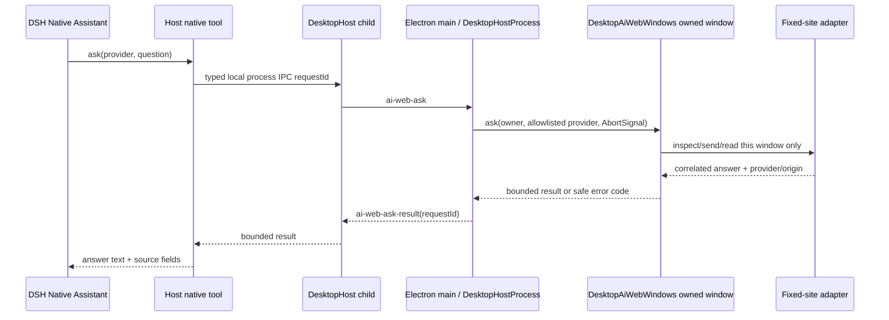

# 原生助手调用网页 AI：接线合同（只读设计）

## 已核对的边界

核对对象为 runtime 16 源码快照
`C:\Users\23825\Desktop\ICT\workspace\runtime\tradeloom-harness\releases\0.2.1-rc.3-tradeloom-desktop-16`
及 TradeLoom `packages/tradeloom-shell/host.js`。

| 位置 | 当前事实 | 对接含义 |
|---|---|---|
| `apps/desktop/src/host-process.ts:26-49,53-92` | 父进程接受有限的 `ready/fatal/platform-session/shutdown-complete/update-tasks/quit-inspection` 消息；没有 AI 请求事件。 | 扩展父进程的消息判别器和回调，不能把未知消息伪装成 control response。 |
| `apps/desktop/src/host-process.ts:169-180,198-224,260-280` | `DesktopHostProcess` 创建独占 child IPC pipe；父进程以 `requestId` 关联它发出的 control 请求。 | 在同一 child pipe 上加独立的 AI ask 请求/取消分支，响应仍以 `requestId` 关联。 |
| `apps/desktop-host/src/index.ts:25-28,49-60,93-106` | Node-mode child 启动 profile、监听 parent IPC、启动后拥有 DSH `ctx`，并最后给 parent 发 `ready`。 | 在发送 `ready` 前安装 Host tool 和 child-side ask broker；不要让网站或 renderer 调用 pipe。 |
| `apps/desktop/src/main.ts:477-483,521-536,796-810` | Electron main 持有 `hostUrl/hostCookie`、`DesktopAiWebWindows` 实例和原生窗口 API；产品 renderer IPC 有 `assertProductSender`。 | 新的 Host child 请求由 `DesktopHostProcess` 专用 callback 进入 main；main 再用既有 owned window 实例完成 ask。它不是 renderer IPC。 |
| `apps/desktop/src/browser-guests.ts:175-` | `DesktopAiWebWindows` 管理主进程所拥有、使用独立持久 session 的 AI BrowserWindow；现有操作包含 toggle/status/upload/saveText。 | 新 `ask` 入口应留在该 owner/controller 内，站点 adapter 只读写此实例的网页 DOM。 |
| `packages/tradeloom-shell/host.js:22,64,162,338,381,410,441,493,517-526` | 业务插件通过 `ctx.tools` 注入；现有 HTTP handlers 先调用 `ctx.connection.requestRejection(req)`；mobile link 使用 `authenticatedUrl(origin)`。 | O06 是 Host 的 native tool，走 `ctx.tools` 和进程 IPC，不新增 HTTP route、不复用 mobile link。 |
| runtime `packages/client/connection/src/browser-auth.ts:244`、`rpc-host.ts:123,198-199` | `authenticatedUrl` 把 process launch token 放在 URL 查询参数；`requestRejection` 对 HTTP request 做 Host/Origin 与 peer/auth 校验。 | launch URL、cookie、authorization/token header 都不得进入 AI tool arguments、child ask payload 或网站 adapter。 |

现有 runtime IPC 没有可直接复用的 AI ask 方法；此文档描述的是待实现协议，不代表接线已存在或运行验证。

## 最窄调用路径



工具定义可作为 runtime 16 `apps/desktop-host/src/native-ai-web-tool.ts`
中的 Host plugin 实现，`inject = ['tools']`，使用已有
`ctx.tools.register(...)` API；`desktop-host/src/index.ts` 在取得 `ctx` 后、发送
`ready` 前 `await ctx.plugin(...)` 安装它。工具执行必须把已存在的
`ToolRunContext.signal` 转发到 child broker；runtime 16
`packages/core/tools/src/index.ts:327-420` 将其定义为必需 caller-owned
AbortSignal。只读检查表明 `runProfile` 在返回前已经完成插件 composition，故
不要假设在 `index.ts` 的 `await application` 之前能把新 service 注入既有插件；上述
新 Host plugin 使用现有 `ctx.plugin(...)` 扩展点，而不是猜测 retroactive injection。

## Typed process IPC 合同草案

以下是建议的协议形状，需在主/子两端各自验证。它当前**不存在**。

```ts
type AskRequest = {
  type: 'ai-web-ask'
  requestId: number // safe integer, child-generated, outstanding request only
  provider: 'deepseek' | 'doubao' // closed allowlist; validate at both ends
  question: string // non-empty, <= 60,000 characters
}

type AskCancel = {
  type: 'ai-web-ask-cancel'
  requestId: number
}

type AskResponse = {
  type: 'ai-web-ask-result'
  requestId: number
  ok: true
  result: {
    provider: 'deepseek' | 'doubao'
    origin: string // adapter's verified fixed site origin
    text: string // controller's <= 60,000 character cap
    turnId: string
  }
} | {
  type: 'ai-web-ask-result'
  requestId: number
  ok: false
  errorCode: NativeAiWebFailureCode // bounded enum only; no raw DOM/exception text
}
```

要求：

1. 父进程仅接受由当前 `DesktopHostProcess` child handle 发来的请求；严格检查
   exact keys、safe-integer requestId、provider allowlist、question 字符上限及
   child/window 生命周期。重复 requestId 拒绝。
2. Parent 收到请求后用一个 `AbortController` 绑定 requestId；cancel、Host child
   disconnect、应用 shutdown、AI window close 都中止本次调用。Host cancel 只取消
   自己的请求，不操作别的窗口/站点任务。
3. `DesktopAiWebWindows.ask` 固定映射 owner 与 site controller，不能接受 URL、路径、
   selector、cookie、token 或任意脚本参数。网页窗口只接触站点网页 DOM。
4. `NativeAiWebAskError.code` 映射为窄枚举返回；不透传 `error.message`、堆栈、DOM
   内容、磁盘路径或账户信息。结果只包含本次 answer text、turnId、固定 provider 与
   origin。
5. `Host` child 的工具等待 parent result 时必须传递 `exec.signal`，发出 cancel IPC，
   并等待 adapter 达到 quiescence。父进程不能因为 UI/Host 请求超时就释放站点锁并放行
   第二个未确认停止的 send。
6. 不建立 `127.0.0.1` unauthenticated endpoint，不调用现有 authenticated HTTP URL；
   不把 Host `url`、cookie、process launch token 或任何 DSH credential 发给网页。

## 预期需要改的文件（主会话批准合同后再做）

1. Runtime `apps/desktop/src/host-process.ts`：添加 ask/cancel request discriminant，
   callback、child response/取消关联、错误和退出清理；保留既有 control event 校验。
2. Runtime `apps/desktop-host/src/index.ts`：安装 Host ask tool plugin；添加 child 端
   requestId broker，监听 parent `ai-web-ask-result` 并实现取消。新增
   `apps/desktop-host/src/native-ai-web-tool.ts` 专管 `ctx.tools.register` 和 signal
   转发。
3. Runtime `apps/desktop/src/main.ts`：为 `DesktopHostProcess` 提供 main-owned ask
   callback，将 child 请求绑定到当前 desktop owner/window 生命周期并调用已有
   `DesktopAiWebWindows`。
4. Runtime `apps/desktop/src/browser-guests.ts`：加 `ask(owner, request, signal)`，为
   每个固定 provider 持有 controller/adapter；校验窗口仍是 owner 且 origin 合法。
   真实站点 adapter 必须等 DOM 属性采集通过后再实现。
5. Runtime 源码源自冻结 runtime 16 checkout；交付实际变更时应通过当前 DSH patch
   工作流生成独立补丁，不直接改 immutable release 树。`packages/tradeloom-shell/host.js`
   无需新增 HTTP route；如果改成业务插件注册工具，则需额外、安全地将 Host-only
   bridge service 注入插件，但本合同推荐 desktop-host 自己安装工具以避免网页 API
   通道。

## 未完成与证据边界

- 当前仅实现和严格类型检查了共享 controller `ask.ts`。
- 真实站点 selector/sending/answer correlation 未验证；DOM 属性采集等待中，所以没有
  真实 adapter。
- Parent/child ask IPC 尚未构造、编译或运行。
- 本合同是待审设计，不表示 native assistant 已能调用网页 AI，也不表示 O06 完成。
